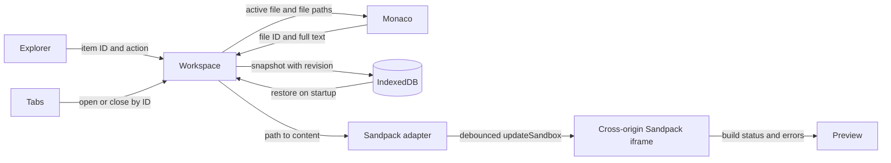

# ⁧معماری Forge Studio⁩

⁧پوستهٔ IDE و پروژهٔ نمونه دو برنامه‌اند. Vite پوسته را اجرا و build می‌کند. Sandpack فایل‌های مجازی پروژه را در iframe مستقل اجرا می‌کند. دادهٔ اصلی پروژه در React state نگهداری می‌شود و IndexedDB تصویر آخرین ذخیرهٔ موفق را نگه می‌دارد.⁩

## ⁧مسئولیت فایل‌ها⁩

- ⁧`src/main.tsx` برنامهٔ React را در `#root` بالا می‌آورد. `src/app/App.tsx` پروژهٔ فعال را انتخاب می‌کند و کامپوننت `Workspace` در همان فایل رویدادهای Explorer، تب‌ها، ویرایشگر و فرم‌ها را هماهنگ می‌کند. `src/app/styles.css` چیدمان، رنگ، فوکوس، فاصله و حالت نمایش باریک را مشخص می‌کند.⁩
- ⁧`src/features/project/tree.ts` عملیات خالص درخت و استخراج مسیر را دارد. `project.ts` نمونهٔ پروژه، حالت تب‌ها و عملیات ویرایش محتوا را می‌سازد. `template.ts` محتویات ثابت قالب چندفایلی React را تعریف می‌کند. `useWorkspace.ts` وضعیت پروژه‌ها و چرخهٔ بازخوانی و ذخیره را در React نگه می‌دارد.⁩
- ⁧`src/features/workspace/Explorer.tsx` شاخه‌های باز، نتیجهٔ جست‌وجو و ابزارهای فایل را رسم می‌کند. `TabBar.tsx` برای انتخاب و بستن تب از شناسهٔ فایل استفاده می‌کند. `WorkspaceDialog.tsx` نام، پوشهٔ مقصد یا تأیید حذف را می‌گیرد. `ResizeHandle.tsx` عرض Preview را با اشاره‌گر و صفحه‌کلید تغییر می‌دهد.⁩
- ⁧`src/features/workspace/monaco.ts` تم، زبان و workerها را تنظیم می‌کند. `EditorPane.tsx` عمر editor و مدل‌ها و ارسال تغییر متن به React را مدیریت می‌کند. `PreviewPane.tsx` اتصال Sandpack، وضعیت ساخت و خطا و عملیات Reload را دارد. `src/features/runtime/sandpack.ts` فقط شکل فایل‌ها را به قرارداد Sandpack تبدیل می‌کند.⁩
- ⁧`src/lib/workspaceDb.ts` نسخه‌بندی دادهٔ ذخیره‌شده، اعتبارسنجی فایل‌ها و تراکنش‌های IndexedDB را دارد. `tests/project.test.ts` منطق خالص را می‌سنجد. `tests/browser/` از UI و Preview واقعی استفاده می‌کند. تنظیم‌های TypeScript، ESLint، Vite و Playwright در ریشه هستند.⁩

## ⁧شناسه، مسیر و ویرایش متن⁩

⁧هر ورودی یک `id` ثابت، `parentId`، `name` و `kind` دارد. فایل افزون بر این‌ها `content` دارد. مسیر از والدها ساخته می‌شود. بنابراین انتقال یا تغییرنام پوشه مسیر فرزندان را تغییر می‌دهد و شناسهٔ تب‌های آن‌ها ثابت می‌ماند. حذف، فرزندان و تب‌های مربوط را جمع می‌کند. importها طبق متن فایل باقی می‌مانند و نتیجهٔ تغییر مسیر را Sandpack نشان می‌دهد.⁩

⁧Monaco هنگام تایپ شناسه و متن کامل مدل را ارسال می‌کند. تغییر با setter تابعی روی جدیدترین پروژه اعمال می‌شود. هر فایل باز یا بسته در همان پروژه یک مدل Monaco دارد، بنابراین بستن تب، undo همان مدل را پاک نمی‌کند. با تغییر URI، مدل جدیدی برای مسیر جدید ساخته می‌شود و view state انتقال می‌یابد. تاریخچهٔ undo مدل قدیمی با آن dispose می‌شود. خروج از پروژه، مدل‌های آن را آزاد می‌کند.⁩

## ⁧اجرا و ذخیره⁩

⁧از snapshot فایل‌ها، نگاشت مسیر به متن ساخته می‌شود. `PreviewPane` بین آخرین تغییر و ارسال snapshot حدود ۲۲۰ میلی‌ثانیه صبر می‌کند تا موج تایپ به درخواست‌های زیاد تبدیل نشود. این وقفه فقط برای Preview است. اگر ساخت شکست بخورد، خطای واقعی همراه آخرین خروجی موجود نمایش داده می‌شود. پس از ۲۰ ثانیه بدون پاسخ، پیام بررسی شبکه و Reload دیده می‌شود.⁩

⁧در اولین بار بارگذاری، IndexedDB قبل از ساخت پروژهٔ نمونه بررسی می‌شود. اگر دادهٔ موجود خوانده نشود، ویرایش در همان جلسه ممکن است و دادهٔ ذخیره‌شده بازنویسی نمی‌شود. نوشتن‌ها به‌ترتیب صف می‌شوند. تراکنش نسخهٔ مورد انتظار را با نسخهٔ فعلی مقایسه می‌کند تا یک تب قدیمی نتواند دادهٔ جدیدتر تب دیگر را جایگزین کند. ذخیرهٔ تب قدیمی در صورت برخورد متوقف می‌شود و متن آن تا زمانی که تب باز است در حافظه می‌ماند.⁩

⁧ذخیره به origin و پروفایل مرورگر وابسته است. بسته شدن فوری صفحه پیش از پیام `Saved locally` ممکن است آخرین تغییر را ذخیره‌نشده بگذارد. Undo پس از reload باقی نمی‌ماند. Monaco تکمیل و بررسی نحوی محلی دارد. بررسی معنایی وابستگی‌های npm در ویرایشگر فعال نیست. Preview برای اجرای نمونه به شبکه و bundler خارجی نیاز دارد.⁩
