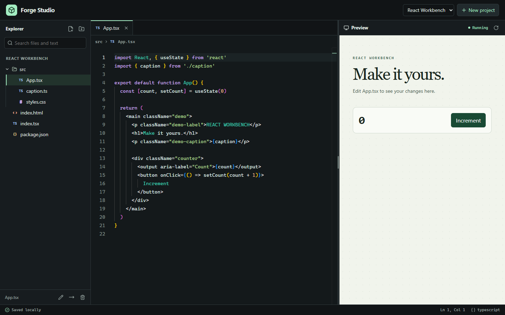

# ⁧شواهد مرحلهٔ ۲: هستهٔ IDE⁩

⁧وضعیت `verified` در محیط محلی. آزمون‌ها روی Windows با Node `22.23.5`، npm `10.7.0` و Chrome `157.0.8103.80` در حالت headless اجرا شدند. آزمون مرورگر Vite را روی `127.0.0.1:4173` راه‌اندازی کرد و خروجی را در iframe واقعی Sandpack بررسی کرد.⁩

## ⁧آزمون‌های پروژه⁩

- ⁧`npm ci` — `pass`. نصب از lockfile انجام شد. npm دربارهٔ پایان پشتیبانی ESLint 9 هشدار داد.⁩
- ⁧`npm run typecheck` و `npm run lint` — `pass`.⁩
- ⁧`npm run test` — `pass`، ۷ آزمون. ساخت، حذف، تغییرنام، انتقال و حفظ شناسه، جلوگیری از نام تکراری و چرخه، تب فعال، ذخیره/بازیابی داده و رد ساختار خراب بررسی شدند.⁩
- ⁧`npm run build` — `pass`. Vite دربارهٔ اندازهٔ chunkها هشدار داد. فایل ورودی JavaScript حدود ۳٫۷ مگابایت و worker تایپ‌اسکریپت حدود ۶ مگابایت قبل از فشرده‌سازی بودند.⁩
- ⁧`npm run test:e2e` با `PLAYWRIGHT_CHANNEL=chrome` — `pass`، ۵ آزمون. زمان اجرای مجموعهٔ ثبت‌شده ۵۸ ثانیه بود.⁩
- ⁧خروجی build — `pass`. Vite Preview روی درگاه 4273 پاسخ HTTP 200 داد و Chromium هم textbox واقعی Monaco و هم عنوان اولیه داخل iframe را مشاهده کرد.⁩

## ⁧رفتارهای دیده‌شده در مرورگر⁩

- ⁧ویرایش عنوان، کلیک شمارنده از ۰ به ۱، ویرایش ماژول دوم، خطای نحوی و بازیابی پس از اصلاح — `pass`. یک اجرای مرحلهٔ ۲، اولین عنوان را حدود ۱۴٫۷ ثانیه بعد از شروع navigation و عنوان ویرایش‌شده را حدود ۴۲۹ میلی‌ثانیه بعد از شروع ورود متن نشان داد. این مشاهدهٔ تک‌نمونه شامل شبکه و انتظار assertion است. اعداد مرحلهٔ ۱ مربوط به commit مستقل‌اند.⁩
- ⁧ساخت و انتخاب پروژه، ساخت پوشه و فایل، import از فایل جدید، تغییر سریع بین فایل‌ها، بستن و بازکردن تب، undo/redo و یافتن فایل با متن — `pass`.⁩
- ⁧تغییرنام با حفظ تب، انتقال ماژول و حفظ متن، خطای import برای مسیر قدیم، اصلاح import و حذف همراه خطای واقعی — `pass`.⁩
- ⁧گسترش و جمع‌کردن Explorer، رد نام تکراری و نام نامعتبر، لغو حذف و تأیید حذف پوشهٔ پر، حالت بدون فایل، resize با صفحه‌کلید و اشاره‌گر — `pass`.⁩
- ⁧بازیابی پروژه، تب، فایل فعال و متن پس از reload، بازکردن پروژهٔ دیگر، و جلوگیری از بازنویسی ذخیره توسط تب قدیمی — `pass`.⁩
- ⁧تکمیل استاندارد Monaco، عرض ۳۹۰ پیکسل و خطای قابل مشاهده هنگام اختلال ساختگی IndexedDB — `pass`. برای این بخش دسترسی به IndexedDB در آزمون به‌عمد خطا می‌دهد. آزمون‌های ذخیره و بازیابی از IndexedDB واقعی استفاده می‌کنند.⁩

⁧تصویر توسط Playwright پس از مشاهدهٔ وضعیت Running گرفته شد. تست‌های تعاملی در `tests/browser/runtime.spec.ts` و `tests/browser/workspace.spec.ts` و تنظیم اجرا در `playwright.config.ts` قرار دارند. آزمون خارجی سقف انتظار ۳۰ ثانیه برای assertion و ۹۰ ثانیه برای سناریو دارد. در GitHub Actions نیز ساخت و اجرای Chromium در workflow `Checks` تعریف شده‌اند.⁩

## ⁧محدودیت‌ها⁩

- ⁧Preview برای bundler و وابستگی‌ها به شبکه نیاز دارد. در خطای build، آخرین خروجی سالم ممکن است زیر پیام بماند. تست‌های ثبت‌شده از اجرای شبکه‌ای واقعی استفاده کردند.⁩
- ⁧بررسی نحوی و تکمیل محلی Monaco آزموده شد. بررسی معنایی وابستگی‌های npm در editor و بازنویسی خودکار import پس از rename یا move در این نسخه وجود ندارند. Undo در همان مدل نگه داشته می‌شود و با تغییر URI، خروج از پروژه یا reload تاریخچه از آن مدل جدا می‌شود.⁩
- ⁧IndexedDB به origin و پروفایل مرورگر وابسته است. کار هم‌زمان دو تب ادغام نمی‌شود. اگر ذخیره تعارض داشته باشد، کار در تب قدیمی تا هنگام بسته‌شدن صفحه در حافظه باقی می‌ماند.⁩
- ⁧آزمون رابط به Chromium محدود بود. Firefox و Safari و اجرای آفلاین bundler بررسی نشده‌اند. عملکرد پروژه‌های بزرگ نیز اندازه‌گیری نشده است.⁩
