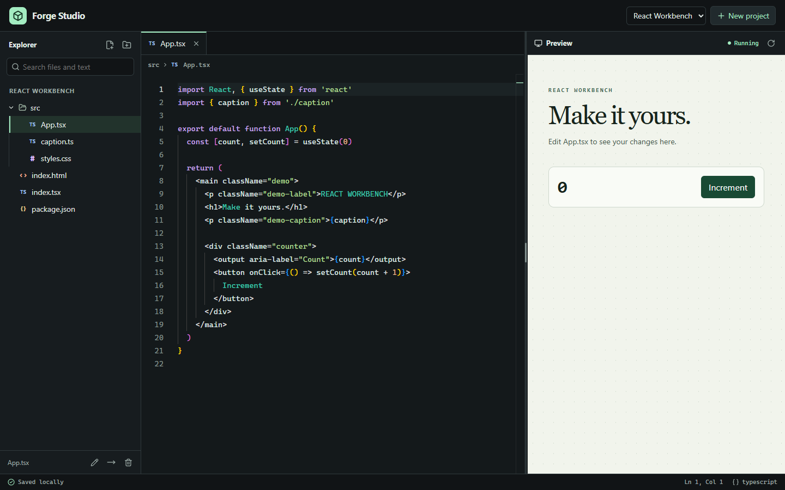

# گزارش پیشرفت ماهانه شماره ۱ پروژه کارشناسی

**نام پروژه:** Forge Studio

**موضوع پروژه:** طراحی و پیاده‌سازی محیط توسعه یکپارچه تحت وب با قابلیت ویرایش بصری و دستیار هوشمند

## ۱. هدف این دوره

در این دوره تمرکز پروژه بر دو مرحله اول، یعنی بررسی امکان اجرای برنامه‌های React در مرورگر و پیاده‌سازی بخش اصلی محیط توسعه (IDE) بود. هدف این بود که ابتدا یک نمونه قابل اجرا از پروژه آماده شود تا در مراحل بعد بتوان امکانات پیشرفته‌تر را به آن اضافه کرد.

## ۲. فعالیت‌های انجام‌شده

### مرحله اول: بررسی اجرای React در مرورگر

برای شروع پروژه از React، TypeScript و Vite استفاده شد. پس از بررسی ابزارهای موردنیاز، Monaco Editor برای ویرایش کد و Sandpack برای اجرای برنامه React در مرورگر انتخاب شدند.

در ابتدا یک برنامه ساده React شامل یک عنوان، شمارنده و چند فایل ساخته شد تا ارتباط بین ویرایشگر و بخش نمایش خروجی بررسی شود. با تغییر کد در ویرایشگر، خروجی برنامه نیز در مرورگر تغییر می‌کند و کاربر نیازی به خروج از محیط توسعه ندارد.

همچنین ایجاد خطای نحوی در کد، نمایش پیام خطا و اجرای مجدد برنامه پس از اصلاح کد مورد بررسی قرار گرفت.

### مرحله دوم: طراحی و پیاده‌سازی محیط اصلی IDE

بعد از آماده شدن نمونه اولیه، رابط کاربری اصلی پروژه طراحی و پیاده‌سازی شد. این محیط دارای تم تیره و ساختاری مشابه محیط‌های برنامه‌نویسی است. بخش‌های اصلی آن عبارت‌اند از:

- امکان ایجاد و باز کردن پروژه‌های مختلف
- نمایش ساختار فایل‌ها و پوشه‌ها در بخش File Explorer
- ایجاد، حذف، تغییر نام و جابه‌جایی فایل‌ها و پوشه‌ها
- باز کردن چند فایل به‌صورت هم‌زمان در تب‌های مختلف
- ویرایش کد، رنگ‌بندی دستورات و تکمیل خودکار در محدوده امکانات Monaco
- جست‌وجو در محتوای فایل‌های پروژه
- نمایش خروجی برنامه در بخش Preview و امکان تغییر اندازه این بخش

برای ذخیره اطلاعات نیز از IndexedDB استفاده شد تا پروژه‌ها و تغییرات فایل‌ها در مرورگر ذخیره شوند و پس از بارگذاری مجدد صفحه قابل بازیابی باشند. همچنین برای جلوگیری از بازنویسی ناخواسته اطلاعات هنگام استفاده از دو تب مرورگر، کنترل نسخه ذخیره اضافه شد.

در پیاده‌سازی پایه و آزمون‌های این دو مرحله از ابزار هوش مصنوعی Codex کمک گرفته شد.

## ۳. مشکلات و بررسی‌های انجام‌شده

یکی از مشکلات اولیه، سازگار نبودن نسخه Node.js با ابزار Vite بود که با استفاده از Node.js نسخه 22 برطرف شد. همچنین به دلیل وابستگی Sandpack به شبکه، در بعضی اجراها پیش‌نمایش با مشکل اتصال مواجه شد. در نتیجه، نمایش وضعیت بارگذاری و خطا و امکان بارگذاری مجدد پیش‌نمایش در محیط پروژه در نظر گرفته شد.

برای بررسی عملکرد برنامه، ۷ آزمون واحد و ۵ آزمون مرورگری در نظر گرفته شد که در اجرای موفق ثبت‌شده و در GitHub Actions همگی پاس شدند. بررسی نوع داده‌ها، lint و ساخت نسخه نهایی نیز موفق بود. در یک اجرای مجدد روی ویندوز، دو آزمون وابسته به شبکه به دلیل قطع اتصال Sandpack کامل نشدند.

## ۴. نتیجه این دوره

در حال حاضر نسخه اولیه Forge Studio آماده شده و امکان ایجاد پروژه، مدیریت فایل‌ها، کدنویسی، مشاهده خروجی واقعی React و ذخیره اطلاعات در مرورگر وجود دارد. کد پروژه و مستندات مربوط به دو مرحله اول در GitHub ثبت شده‌اند.

دو مرحله اول در محدوده تعیین‌شده و در مرورگر Chromium تکمیل و بررسی شده‌اند. امکانات ویرایش بصری و دستیار هوشمند هنوز پیاده‌سازی نشده‌اند.

## ۵. برنامه دوره بعد

برای دوره بعد قصد دارم ابتدا روش‌های اجرای برنامه در مرورگر را بیشتر بررسی کنم و Sandpack و WebContainers را از نظر امکانات و محدودیت‌ها مقایسه کنم. سپس بر اساس نتیجه این بررسی، توسعه بخش اجرای برنامه، ترمینال و مدیریت خروجی دستورات را ادامه دهم.

**آدرس مخزن پروژه:** https://github.com/aynazhz/Forge-Studio
